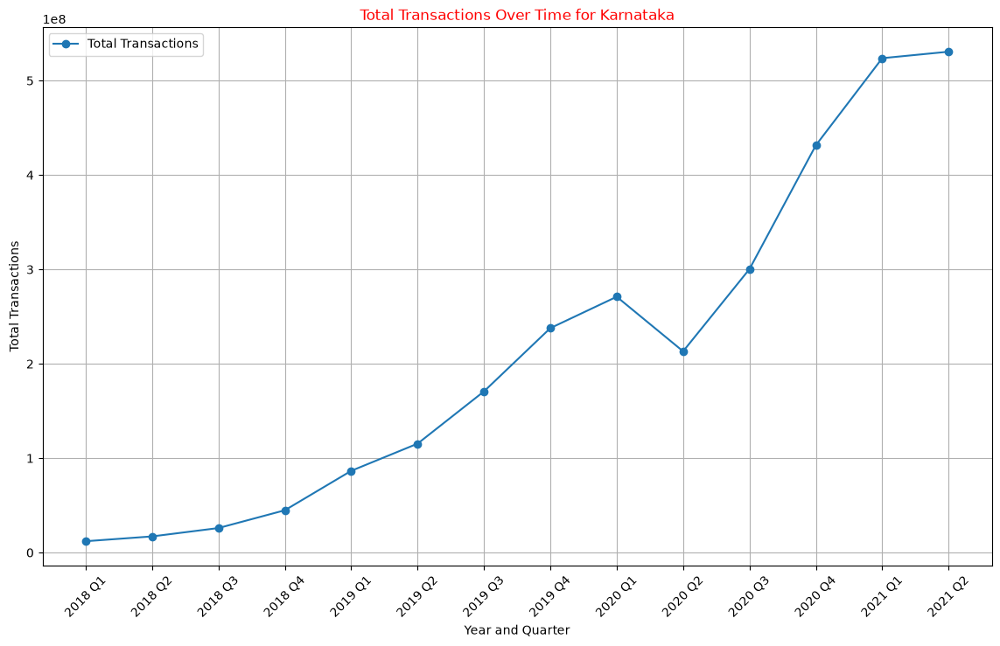
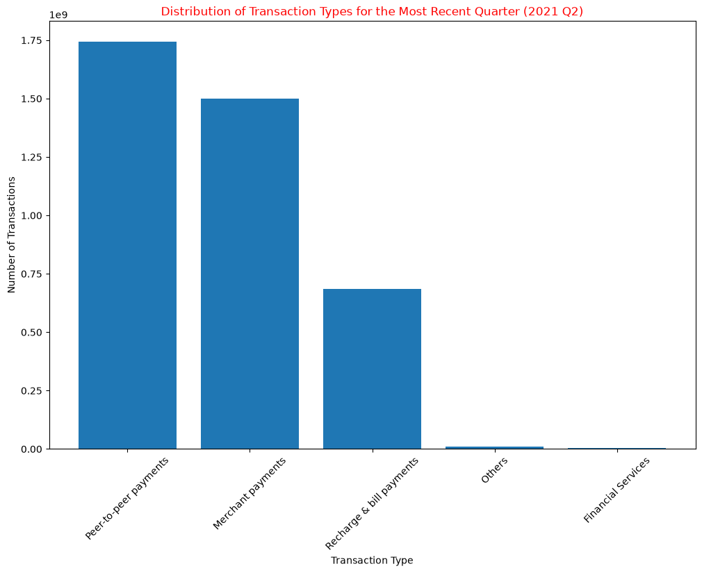
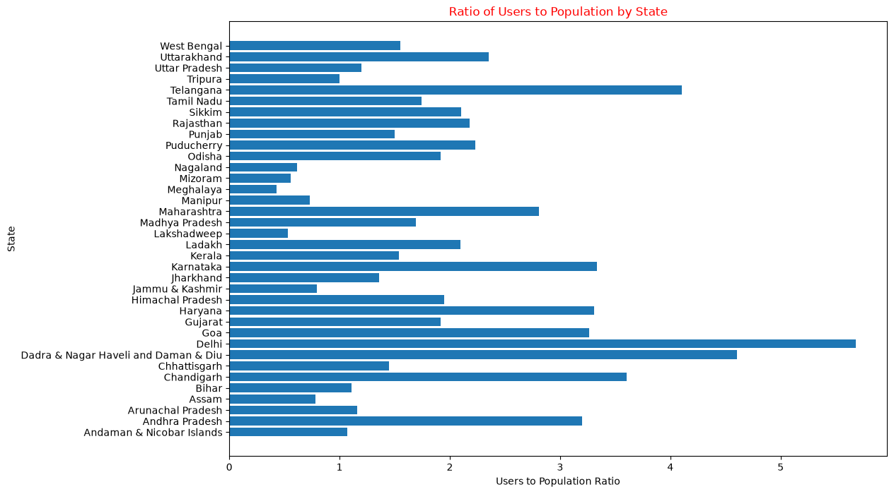
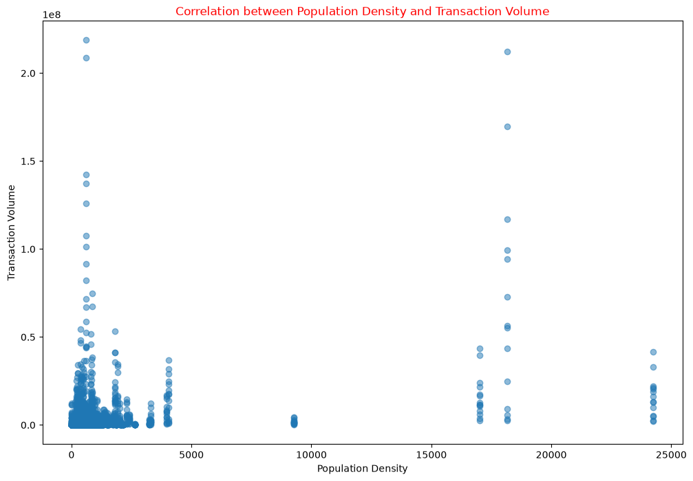
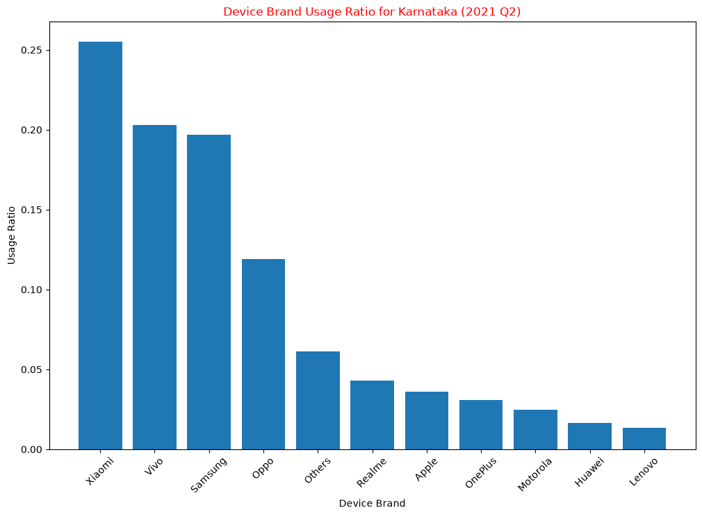
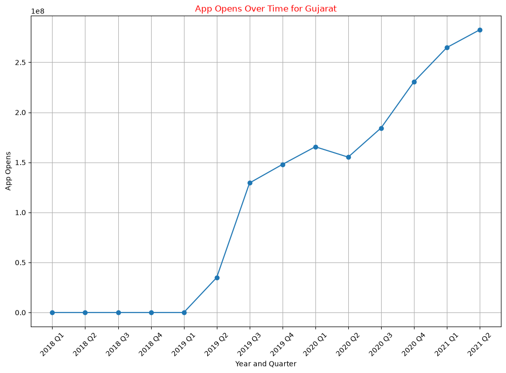
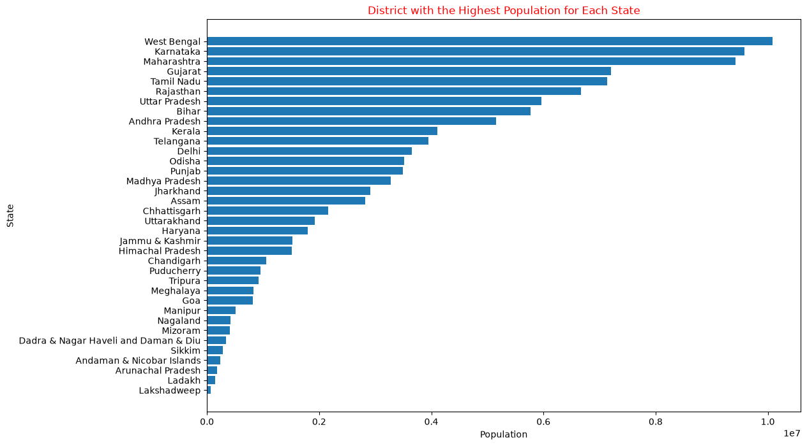

# PhonePe Pulse: India's Digital Payments Analysis


An exploratory analysis of **PhonePe Pulse**, the public UPI payments data from one of India's largest payment apps. The project uses five related Excel sheets with state, district, transaction-type, device and census data from **2018 Q1 to 2021 Q2**. They are loaded, checked, merged and analysed in **pandas** to answer **34 questions**: who pays digitally, how much, on what, and where adoption still lags.

**[📓 Open the notebook](phonepe_pulse_case_study.ipynb)**



---

## 📑 Contents

- [Key Findings](#-key-findings)
- [Dataset](#-dataset)
- [Workflow](#️-workflow)
- [Questions Answered](#-questions-answered)
- [Visualisations](#-visualisations)
- [Skills Demonstrated](#-skills-demonstrated)
- [Data Issues Found](#-data-issues-found)
- [How to Run](#️-how-to-run)
- [Author](#-author)

---

## 💡 Key Findings

| | |
|---|---|
| **Scale** | **20.5 billion transactions worth ₹35.6 lakh crore** across 36 states/UTs and 723 districts |
| **Growth** | Quarterly transactions rose about **29×**, from 134M (2018 Q1) to 3.94B (2021 Q2) |
| **Top states by volume** | **Karnataka 2.98B**, Maharashtra 2.83B, Telangana 2.35B, Andhra Pradesh 1.78B, Rajasthan 1.38B |
| **Payment mix (2021 Q2)** | Peer-to-peer **44%**, merchant **38%**, recharge & bills 17% |
| **Phones** | **Xiaomi** has the most users in **35 of 36** states |
| **Highest penetration** | **Delhi ~0.67** registered users per resident, then Telangana ~0.50 and Karnataka ~0.42 |
| **Lowest penetration** | **Meghalaya ~0.06**, then Lakshadweep, Mizoram and Nagaland |
| **Strongest driver** | Registered users ↔ transactions correlation **0.80**; population density ↔ transactions only **0.31** |

**What stands out**

- **Volume and value move in opposite directions.** Karnataka and Maharashtra lead on volume but have among the *lowest* average transaction values (~₹1,517). Many small everyday payments pull the average down. Remote regions like Ladakh (~₹3,408) and the Andaman & Nicobar Islands make fewer but larger payments.
- **UPI is becoming a way to pay shops, not just people.** Peer-to-peer payments led in 311 of 504 state-quarters. By 2021 Q2, merchant payments were 38% of all transactions as shops adopted UPI QR codes.
- **COVID caused a dip, then a sharp acceleration.** Transactions fell 11% in 2020 Q2 (lockdown), then grew 2.4× in the next three quarters (1.45B → 3.46B). The first half of 2021 alone almost matched all of 2020.
- **Demographics explain little.** Density and population correlate only weakly with transactions (0.31–0.36). User adoption is what drives volume, which points to factors like urbanisation, income and internet access.

---

## 📊 Dataset

One Excel workbook, `phonepe.xlsx`, from the [PhonePe Pulse](https://github.com/PhonePe/pulse) public data release (Q1 2018 to Q2 2021):

| Sheet | Grain | Rows | Key columns |
|---|---|---|---|
| **State_Txn and Users** | State × quarter | 10,248 | Transactions, Amount, ATV, Registered Users, App Opens |
| **State_TxnSplit** | State × quarter × transaction type | 10,248 | Transactions, Amount, ATV per payment type |
| **State_DeviceData** | State × quarter × phone brand | 10,248 | Registered Users, share by brand |
| **District_Txn and Users** | District × quarter | 10,248 | Transactions, Amount, ATV, Registered Users, App Opens |
| **District Demographics** | District | 742 | Headquarters, Population, Area, Density, Code |

*ATV (average transaction value) = Amount ÷ Transactions.*

---

## ⚙️ Workflow

```text
Excel workbook ──► Load 5 sheets ──► Explore & profile ──► Missing-value audit ──► Aggregate & merge ──► Analyse & visualise
                   pd.read_excel     describe, dtypes      % missing by column     groupby, merge on       rankings, ratios,
                                                                                    State/District/Quarter  correlations, trends
```

1. **Load** each sheet into its own DataFrame and preview it with `head`, `tail`, middle slices and every 10th row.
2. **Profile** with summary statistics, data types and missing-value percentages per column.
3. **Aggregate** by state, year, quarter, transaction type and brand with `groupby().agg()`. Pick the winner in each group with `idxmax()`.
4. **Merge** transaction data with demographics and device data at the right grain (`State + Year + Quarter`).
5. **Validate**: recompute state totals from district data and reconcile them with the state sheet.
6. **Analyse and visualise** rankings, ratios, trends and correlations, with a written observation for each finding.
7. **Export** a district name → code mapping to [`unique_district_mapping.csv`](unique_district_mapping.csv).

---

## ❓ Questions Answered

| Section | What's covered |
|---|---|
| **1–3. Load, explore, clean** | Load 5 sheets · summary statistics · data types · missing-value counts and percentages |
| **4. Geography** | Number of states and districts · state with the most districts |
| **5. Transactions** | Totals by state and year · top/bottom 5 states · most common transaction type per state-quarter |
| **6. Devices** | Leading phone brand per state |
| **7. Demographics** | Most populous district per state |
| **8. Transaction value** | ATV by state · top/bottom 5 |
| **9. App usage** | App opens over time (Gujarat) |
| **10. Payment mix** | Transaction types in the latest quarter |
| **11. District codes** | Unique district → code mapping exported to CSV |
| **12. Consistency check** | District totals vs state totals |
| **13. Penetration** | Registered users ÷ population by state |
| **14. Density** | Population density vs transaction volume |
| **15. Value per user** | Average amount per user · top/bottom 5 states |
| **16. Brand share** | Each brand's share of registered users |
| **17. Visualisations** | Transactions over time · payment-type pie · district density |
| **18. Trends & correlations** | Yearly growth · correlation matrix of demographics vs transactions |

---

## 📈 Visualisations

| | |
|---|---|
|  |  |
| **Payment mix, 2021 Q2** | **Users ÷ population by state** |
|  |  |
| **Density vs transactions (r = 0.31)** | **Phone brand share, Karnataka** |
|  |  |
| **App opens, Gujarat** | **Most populous district per state** |

All 9 charts are in [`images/`](images/).

---

## 🧠 Skills Demonstrated

| Area | Techniques |
|---|---|
| **Data loading** | Multi-sheet Excel with `read_excel`, slicing with `iloc` (middle rows, every n-th row) |
| **Data profiling** | `describe`, `dtypes`, `isnull().mean()` for missing-value percentages |
| **Aggregation** | `groupby().agg()`, `idxmax()` to pick the top item per group, `nunique`, `value_counts` |
| **Joining data** | `merge` on composite keys (`State + Year + Quarter`, `State + District + Code`) |
| **Validation** | Reconciling district vs state totals, float tolerance instead of exact `==` |
| **Statistics** | Correlation matrix with `corr()`, ratios, growth comparisons |
| **Visualisation** | Line, bar, horizontal bar, scatter and pie charts in Matplotlib |
| **Analytical judgement** | Catching double counting, e.g. summing a running total of users gives ratios above 1, so the latest quarter is used instead |

---

## 🔍 Data Issues Found

Treating the data critically was part of the analysis:

- **Missing amount:** Andhra Pradesh's state-level `Amount` for **2021 Q1 is blank**. It's the only state whose district totals don't reconcile with the state sheet.
- **Floating-point noise:** an exact `==` comparison flagged almost every state's amount as mismatched. A ₹1 tolerance shows they match.
- **Running totals:** `Registered Users` is cumulative, so summing it across quarters overstates users. Penetration uses the latest quarter only.
- **Rows vs districts:** counting rows in the district transaction sheet suggests Uttar Pradesh has 1,050 districts, but each district repeats once per quarter. The demographics sheet gives the true count of 75.
- **App opens** were not reported before 2019 Q2 (zeros in the data).
- **District codes:** 28 missing in the transaction sheet; population figures come from the census, so ratios are approximate.

---

## ▶️ How to Run

```bash
git clone https://github.com/parthdhawan921-ops/phonepe-pulse-analysis.git
cd phonepe-pulse-analysis
pip install -r requirements.txt
jupyter notebook phonepe_pulse_case_study.ipynb
```

The dataset (`phonepe.xlsx`) is included. A full run reproduces every output and chart, and regenerates `unique_district_mapping.csv`.

---

## 👨‍💻 Author

**Parth Dhawan**: Data Analyst · SQL · Python · Excel · Power BI

[GitHub](https://github.com/parthdhawan921-ops) · [LinkedIn](https://www.linkedin.com/in/parth-dhawan-31516127a/)
